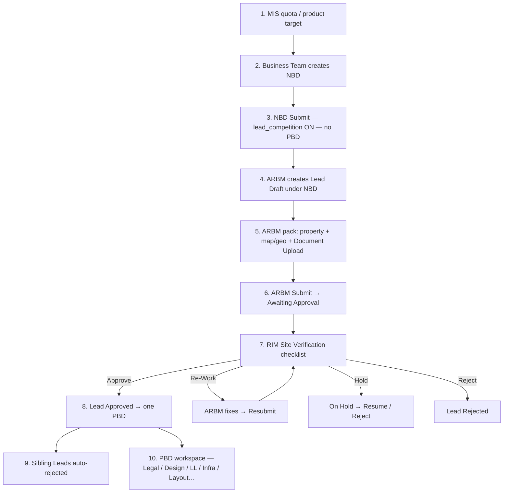

# Chola360 Lead Management — Master Prompt

**Application:** Chola360 (SPA brand / routes only — not a `product_line` value)  
**Backend:** Frappe `infra_ms` — DocTypes under Infra Management System  
**Frontend:** React + Vite SPA `infra-management-app`  
**Date locked:** 1 Nov 2026  

Use this document as the single source of truth for Lead Request implementation.

---

## 1. Core business rules

1. **Many Lead Requests** may compete under one **New Branch Details (NBD)** requirement.
2. **NBD does not create Proposed Branch Details (PBD)** on the Lead-competition path. NBD Submit opens the requirement / MIS quota only; `proposed_branch_id` stays empty until a Lead wins.
3. **Exactly one PBD** is created when **any one Lead Request is Approved** (winner).
4. That PBD is seeded from **NBD (org/requirement) + winning Lead (property pack)**.
5. Sibling / losing Leads are **auto-rejected** and **never** get a PBD.
6. Post-promote stages (Design Sketch, CAD Consent, LL Agreement, Infra Readiness, Layout/BAZ/PO) run only on that **single PBD**.

```
MIS quota → NBD (requirement, no PBD)
                ├─ Lead A (competing)
                ├─ Lead B (winner → Approved)
                └─ Lead C (auto-rejected)
                      │
                      ▼
              One PBD (NBD + Lead B)
                      │
                      ▼
              Design / CAD / LL / Infra / Layout…
```

---

## 2. Naming

| Concept | Value |
|---------|--------|
| Application name | **Chola360** |
| Document name (Lead) | `LEAD/{product_line}/{region}/{####}` |
| UI Property ID | `PRCH-####` (display alias) |
| NBD name | Existing `NBI/…` |
| PBD name | Existing `NBO/…` |

---

## 3. product_line (locked — do not add Chola360)

```
VF
LAP
HL
HO
CSEL
SBPL
SME
CSEC
GL
Payswiff
```

Align Regional Details Select with this list (add **Payswiff** where missing). NBD already matches.

---

## 4. DocType roles

| DocType | Role | Created when |
|---------|------|----------------|
| New Branch Details | Branch-opening **requirement** | Existing MIS → NBD flow |
| Lead Request | Competing **property proposal** | ARBM under open NBD |
| Proposed Branch Details | Winning property **workspace** | **Only** on Lead **Approved** |

**Links**

- Lead.`branch_opening_requirement` → NBD  
- Lead.`proposed_branch` → PBD (after win)  
- PBD.`request_no_new` → NBD  
- NBD.`proposed_branch_id` → PBD (after win only)

---

## 5. Lead Request workflow (short — required)

Frappe Workflow on Lead Request. Source of truth: `workflow_state` (no separate status Select).

| State | Who | Meaning |
|-------|-----|---------|
| Draft | ARBM | Creating / editing pack |
| Awaiting Approval | ARBM → RIM | Submitted |
| Re-Work | RIM → ARBM | Rework with comment |
| On Hold | RIM | Put on Hold |
| Approved | RIM / authorized | **Promote → one PBD** |
| Rejected | RIM / system | Manual or auto-reject |

**Actions:** Submit, Send for Re-Work, Put on Hold, Resume, Resubmit, Approve, Reject.  
Reject / Re-Work require comments. Approve is server-only promote + sibling reject.

**Not on Lead workflow:** Design Sketch / CAD / LL / Infra (those are PBD after promote).

---

## 5A. SOP-aligned role-based flow (ordered steps)

Mapped to Branch Launch SOP V3 **§3.1 ARBM shortlisting** + **§3.2 RIM site verification**, then existing PBD main/design tracks after promote.

### Role map (SOP ↔ system)

| SOP name | System role | Lead access key |
|----------|-------------|-----------------|
| ARBM / BM | **Area Regional Business Manager** | Lead.`arbm_email` = session user |
| RIM | **Regional Infra Business Partner** | NBD.`rb_manager_details` = session user (via Lead.`branch_opening_requirement`) |
| Business Team / MIS | Business Team / MIS roles | Create **NBD** requirement (Lead competition path) |
| Legal / Finance / BH / HO / Design | Existing PBD roles | **After** Lead Approve only (on the single PBD) |

### End-to-end ordered steps



### Step checklist by role

**A. Prerequisite (not Lead)**  
1. MIS / product quota available.  
2. **Business Team** creates **New Branch Details** and enables **Select via Lead Request** (`lead_competition`).  
3. NBD **Submit** consumes quota / opens requirement — **does not** create PBD.

**B. ARBM (SOP §3.1 shortlisting — on Lead Request)**  
4. Open `/chola360/leads` → Create Lead under open NBD.  
5. Capture property pack: location, address, entrance, **map / lat / lng**, premise **Document Upload** child rows (photos/docs).  
6. Save **Draft**; edit until ready.  
7. **Submit** → `Awaiting Approval`.  
8. Track by region/branch cards (Approved / Awaiting / Rejected / Re-Work).  
9. If **Re-Work**: fix pack + comment → **Resubmit**.

**C. RIM (SOP §3.2 site verification — on Lead Request)**  
10. Open Lead in RIM queue (scoped by NBD `rb_manager_details`).  
11. Site Verification: onsite checks (Vaastu / water-logging / road / area-height / religious place).  
12. Actions only for mapped RIM:  
    - **Approve** → winner; creates **one PBD**; siblings auto-rejected.  
    - **Send for Re-Work** (comment required) → ARBM.  
    - **Put on Hold** → later **Resume** or **Reject**.  
    - **Reject** (comment required).

**D. After Approve (SOP §3.4+ — on Proposed Branch only)**  
13. Continue on `/infra/requests/:pbd` — Property Details (RIBP), commercial, Legal/LOI, Design/CAD, LL, Infra Readiness, Layout/BOQ/PO, SD/BAZ, inauguration.  
14. Losing Leads stay Rejected; no PBD for them.

### Action permission matrix (enforced)

| Action | From state | To state | Allowed role |
|--------|------------|----------|--------------|
| Submit | Draft | Awaiting Approval | ARBM owner |
| Resubmit | Re-Work | Awaiting Approval | ARBM owner |
| Send for Re-Work | Awaiting Approval | Re-Work | RIM (mapped) |
| Put on Hold | Awaiting Approval | On Hold | RIM (mapped) |
| Resume | On Hold | Awaiting Approval | RIM (mapped) |
| Approve | Awaiting Approval | Approved (+ PBD) | RIM (mapped) |
| Reject | Awaiting Approval / On Hold / Re-Work | Rejected | RIM (mapped) |
| Auto-reject siblings | — | Rejected | System on Approve |

Admins / HO Infra Branch Admin may override for support.

### Explicitly out of Lead (per SOP + master rules)

- Ann. G readiness / fit-out / SR construction evidence  
- Ann. H SD 50/25/25 payment gates  
- Design Sketch / 3D / CAD Consent / LL Agreement / Infra Readiness  
- Layout / BOQ / PO / BAZ / inauguration  

Those remain on the **single winning PBD** after step 8.

---

## 6. Lead Request fields (summary)

**Envelope:** `branch_opening_requirement`, `property_id`, `proposed_branch`, `workflow_state`, `regional_details`, `product_line`, `region`, `region_code`, `zone`, `area`, `location_details`, `arbm_email`, `initiated_by`, `initiated_date`, `date_of_proposal`, submit/approve/reject metadata, `rework_comment`, `rejection_comment`.

**Property:** address, pin, state, shop, floor, areas, bounds, map/geo, `main_entrance_direction`, deviation.

**Commercial / Facility:** mirror ARBM-relevant PBD fieldnames (rent, SD, lease, parking, power, toilets, etc.).

**Site Verification:** onsite checklist Checks + orientation Yes/No + hold/verified meta.

**Children / LOI:** `owner_details` (NBO Owner Details), `premise_related_document` (Document Upload), `kyc_related_documents` (KYC Document Upload), site photos, LOI attach + `loi_consent_status`.

**Omit from Lead:** RLM/AM query tables, Design/CAD/LL, UTR/strong-room/Layout/BOQ/Ann. G.

**ARBM access filter:** Lead.`arbm_email` = session user (from Regional Details ARBM email at create).  
**RIM access filter:** from **New Branch Details** — `rb_manager_details` (label: Regional Infra Manager) = session user; Lead must link via `branch_opening_requirement`.

---

## 7. Promote transaction (server-only)

On Approve Lead L:

1. Validate role; lock NBD + competing Leads.  
2. Abort if NBD already has `proposed_branch_id` or another Lead Approved.  
3. Create one PBD from NBD + L; insert.  
4. Set `NBD.proposed_branch_id`, `L.proposed_branch`; mark L Approved.  
5. Reject sibling Leads with audit comment naming L.  
6. Never create PBDs for losers; never create PBD from NBD Submit on Lead path.

---

## 8. Figma → DocType cutover

| Screen | Binds to |
|--------|----------|
| ARBM empty / dashboard / create / images / LOI | Lead Request |
| RIM Site Verification | Lead Request (Approve promotes) |
| Web Approval Desk (Property / Rent / Legal) | Lead until Approve |
| Design Sketch, CAD Consent, LL Agreement, Infra | **Single PBD** after promote |

---

## 9. React UI — ARBM first, then roles

**App routes under `/chola360/leads`.** Brand as **Chola360** (not Gold Loan wordmark).

### ARBM Lead home

- **No leads** → empty state: illustration, “Create your first Property Lead”, CTA **Create Lead**.
- **Has leads** → dashboard: Total / Re-work / Rejected / Approved counts + **Leads by Branch** + FAB **+**.

### Role rollout order (same SPA)

1. ARBM — home, create, property pack, submit  
2. RIM — Site Verification (checklist, Hold / Reject / Re-Work / Approve)  
3. Approval Desk — Property / Rent / Legal on Lead  
4. After Approve — hand off to existing `/infra/requests/:pbd` (PBD workspace)  
5. Design / CAD / LL / Infra on PBD  

All interaction in **React**. Portal APIs under `infra_ms.portal.lead_request.*`.

---

## 10. Will not do

- Add `Chola360` as a `product_line` Select value  
- NBD Submit creating PBD on Lead path  
- One PBD per competing Lead  
- Post-promote stages on losing Leads  
- Full ~162-field PBD clone onto Lead  
- Client-side promote or client-side series numbering  

---

## 11. Insight — does this work?

| Layer | Verdict |
|-------|---------|
| React ARBM empty → dashboard | Yes — works in existing Vite SPA |
| Role-by-role React screens | Yes — same app, role-gated modules |
| DocType model (NBD no PBD; one PBD on win) | Yes — requires NBD skip + Approve promote |
| UI without portal/Lead fields | Mock OK for UX; persist/promote needs Frappe |

**Build order:** Master prompt → ARBM React home → Lead DocType/workflow/portal → wire React → RIM/desk → PBD handoff.
