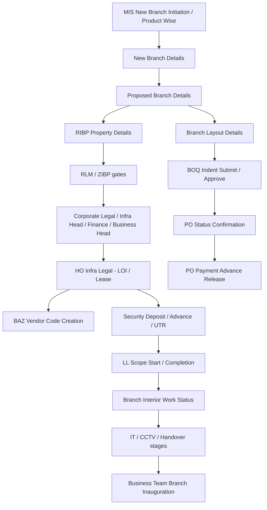

# Chola360 Branch Launch — SOP V3 vs Existing infra_ms Verification

**Type:** Read-only static analysis (no implementation)  
**Date:** 31 Oct 2026  
**Status:** For review and approval — stop before any development  

---

## Sources

| Item | Path |
|------|------|
| Frappe project (authoritative local copy) | `/Users/balramsl/Documents/Latest Development/Infra App/infra_ms` |
| SOP PDF (user-supplied) | `/Users/balramsl/Downloads/Branch Launch SOP V3 (1).pdf` |
| SOP inside project tree | **Not present** (`SOP_IN_PROJECT=0`) |

### SOP availability statement

Branch Launch SOP V3 (2026) is **not located inside** the project directory  
`/Users/balramsl/Documents/Latest Development/Infra App/infra_ms`.

The user supplied a copy at `/Users/balramsl/Downloads/Branch Launch SOP V3 (1).pdf`. That file was used for this verification. The PDF cover identifies it as **Gold Loans — Branch Launch SOP (Mar 2026)**.

**Recommendation:** Place a controlled copy of the SOP (and any Chola360 delta brief) under the project docs folder so future audits do not depend on Downloads.

### Verification status legend

| Status | Meaning |
|--------|---------|
| Confirmed in source | Present in DocType JSON / portal / report code |
| Partially confirmed | Related fields/APIs exist; SOP completeness or enforcement incomplete |
| Not found in source | No matching field, DocType, checklist, or coded procedure |
| Requires runtime verification | Needs live Frappe Workflow / Select options / site config |
| Requires business clarification | GL vs Chola360 applicability or SOP internal inconsistency |

### Mandatory restrictions observed

No Frappe/bench execution, no app code run, no DB/API/Redis access, no migrations, no DocType/workflow/permission changes, no implementation code, no Git modifications to `infra_ms`.

---

## Report 1 — Existing project overview

### Architecture

- App package: `infra_ms` (`pyproject.toml`, `hooks.py`)
- Module: **Infra Management System** → `infra_ms/infra_management_system/`
- DocTypes: `infra_ms/infra_management_system/doctype/` (**~54 doctype folders**)
- Portal API: `infra_ms/portal/` (`workflow.py`, `rules.py`, `proposed_branch.py`, `new_branch.py`, …)
- Reports: `mis_report`, `new_branch_proposal_report`, `proposed_branch_tat_report`, `workflow_aging_report`
- Client JS: per-DocType `*.js` + `public/js/infra_dashboards.js`
- Controllers: per-DocType `*.py` (e.g. `proposed_branch_details.py`)

### Named DocTypes (10) — verified present

| # | DocType | Folder | Controllers | Purpose |
|---|---------|--------|-------------|---------|
| 1 | MIS New Branch Initiation | `mis_new_branch_initiation` | `.py` / `.js` | Annual product-wise branch targets (GL/VF/…) |
| 2 | MIS Product Wise Branch Initiate | `mis_product_wise_branch_initiate` | `.py` / `.js` | Product-line initiate (submittable) |
| 3 | New Branch Details | `new_branch_details` | `.py` / `.js` | Initiate request: year/region/zone/area/`product_line` |
| 4 | Proposed Branch Details | `proposed_branch_details` | `.py` / `.js` | Property + commercial + approvals + deposits (~162 fields) |
| 5 | Branch Layout Details | `branch_layout_details` | `.py` / `.js` | Layout cuts, BOQ indent, PO-related assets |
| 6 | BAZ Vendor Code Creation | `baz_vendor_code_creation` | `.py` / `.js` | Vendor/owner BAZ code ↔ Proposed Branch |
| 7 | PO Status Confirmation Details | `po_status_confirmation_details` | `.py` / `.js` | PO/asset/interior status |
| 8 | PO Payment Advance Release Details | `po_payment_advance_release_details` | `.py` / `.js` | Advance payment status |
| 9 | Query Log Details | `query_log_details` | `.py` / `.js` | Query/response/attachments |
| 10 | Infra User Based Role Master | `infra_user_based_role_master` | `.py` / `.js` | User ↔ role ↔ `product_line` |

JSON permissions on these DocTypes commonly list **System Manager** only in the exported JSON — full role permissions likely live on the site (**Requires runtime verification**).

### Supporting DocTypes / masters (inventory)

Includes: Area Regional Business Manager Master, Product Line Master, Product Wise Branch Initiator Master, Regional / Zone / Area / State masters, NBO Owner Details, NBO Vendor Details, Document Upload, KYC Document Upload, Branch Related Document Upload, Interior Document Upload, Branch Interior Work Status, Scope of Work, Work Scope / Status, Audit Log, Workflow Comment Entry, Premises Details Update, Branch Rejected Details, Proposed Branch Temporary Draft, Cost Estimation tables, Infra Email Sending Workstate Based, UAT Branch Reset, RLM User Access Details, Infra RIBP User Access, Approval Manager Attachment / Levels, etc.

### Integrations

| Integration | Evidence | Status |
|-------------|----------|--------|
| GPS / Map | `map` (Geolocation), `geo_latitude`, `geo_longitude`, `geo_location`; `geo_location_api.py` | Confirmed in source |
| Attachments / “DMS” | Frappe `Attach` + child tables; `controllers/file/` | Confirmed as Frappe File; external DMS API **Not found** |
| Workflow | Site Workflow via `portal/workflow.py`; rules in `portal/rules.py` | Partially confirmed (transitions = runtime) |
| Notifications | Email DocType; `hooks.py` notification blocks largely commented | Partially confirmed |
| Audit / comments | `audit_log`, `workflow_comment_entry`, query tables | Confirmed in source |
| Product lines | Select `VF|LAP|HL|HO|CSEL|SBPL|SME|CSEC|GL|Payswiff` | Confirmed; **Chola360 Not found** |

---

## Report 2 — Complete existing workflow (reconstructed)

**Parallelism:** Main track (Proposed Branch commercial/legal/payment) and Design track (Branch Layout → BOQ → PO) are separate DocTypes linked by `proposed_branch_request_id`. Whether they are non-blocking in parallel is **Requires runtime verification** (site Workflow conditions).

---

## Report 3 — DocType and field inventory (relationships)

| From | Link / Table | To |
|------|--------------|----|
| New Branch Details | `proposed_branch_id` | Proposed Branch Details |
| Proposed Branch Details | `request_no_new` | New Branch Details |
| Proposed Branch Details | `owner_details` | NBO Owner Details (child) |
| Proposed Branch Details | `premise_related_document` | Document Upload (child) |
| Proposed Branch Details | `kyc_related_documents` | KYC Document Upload (child) |
| Proposed Branch Details | `rlm_query_log` / `zibp_query_log` / `am1`–`am4_query_log` / `tenure_related_query` | Query Log |
| Proposed Branch Details | `loi_agreement_upload_*` / advance docs | Branch Related Document Upload |
| Proposed Branch Details | `ribp_work_scope` | Work Scope |
| Proposed Branch Details | `strong_room_work_related_attachment` / door attach | Branch Related Document Upload (tables) |
| Branch Layout Details | `proposed_branch_request_id` | Proposed Branch Details |
| Branch Layout Details | layout comment tables | Branch Layout Details Comment |
| Branch Layout Details | `asset_details` | Cost Estimation Branch Layout |
| BAZ / PO* | `proposed_branch_request_id` | Proposed Branch Details |
| Area Regional Business Manager Master | `product_line` Select | Master for ARBM mapping |

JSON paths (examples):

- `.../doctype/proposed_branch_details/proposed_branch_details.json`
- `.../doctype/branch_layout_details/branch_layout_details.json`
- `.../doctype/nbo_owner_details/nbo_owner_details.json`
- `.../portal/rules.py`

---

## Report 4 — Role and workflow matrix

**Sources:**  
`/Users/balramsl/Documents/Latest Development/Infra App/infra_ms/infra_ms/portal/rules.py`  
`.../report/proposed_branch_tat_report/proposed_branch_tat_report.py` (`STATE_ROLE_MAP`)

Legacy AM labels map to: Corporate Legal Team, Infra Head, Finance Head, Business Head.

| State (code / TAT report) | Typical role | Query gate | Status |
|---------------------------|--------------|------------|--------|
| Assigned to ZIBP for Branch Proposal | Zonal Infra Business Partner | — | Confirmed in source |
| Assigned to RIBP for Property Details | Regional Infra Business Partner | Property edit state | Confirmed in source |
| Assigned to RLM | RLM | `rlm_query_log` | Confirmed in source |
| Assigned to RIBP for RLM Approval | RIBP | `rlm_query_log` | Confirmed in source |
| Assigned to ZIBP | ZIBP | `zibp_query_log` | Confirmed in source |
| Assigned to Approval Manager 1 → Corporate Legal | HO Corporate Legal Team | `am1_query_log` | Confirmed in source |
| Assigned to Approval Manager 2 → Infra Head | Infra Head | `am2_query_log` | Confirmed in source |
| Assigned to Approval Manager 3 → Finance Head | Finance Head | `am3_query_log` | Confirmed in source |
| Assigned to Approval Manager 4 → Business Head | Business Head | `am4_query_log` | Confirmed in source |
| Assigned to HO Infra Legal Team (+ SD / Advance / UTR variants) | HO Infra Legal Team | tenure queries (subset) | Partially confirmed |
| Assigned to RIBP for LL Agreement | RIBP | — | Confirmed in source |
| LL Scope / Tenure / IT / CCTV / Handover / Inauguration states | RIBP / Legal / Payment / Business Team | `tenure_related_query` where mapped | Partially confirmed |
| Branch Layout BOQ Indent / PO Creation | HO Infra Process Owner / Branch Admin (depends_on in JSON) | — | Partially confirmed |
| **STF panel (SOP §3.5)** | Multi-member panel / delegate | — | **Not found in source** |
| Action → next_state edges | Site Workflow | — | **Requires runtime verification** |

Terminal states in `rules.py`: Complete, Branch Inauguration Completed, Cancelled, Rejected.

---

## Report 5 — SOP requirement coverage matrix

| SOP Reference | Requirement | Existing DocType / artifact | Coverage | Chola360 Applicability | Gap |
|---------------|-------------|----------------------------|----------|------------------------|-----|
| §3.1 / Ann. A | ARBM shortlisting + 17-pt checklist | ARBM Master + Proposed Branch fields; no 17-pt checklist | Partially confirmed | Reusable shell | Structured checklist + validations missing; multiple candidate properties **Not found** |
| §3.2 / Ann. B | RIM 9-pt + Vaastu 4-pt | Partial facilities/geo; no Vaastu checklist fields | Partially confirmed | GL-specific confirm | Video/sketch/Vaastu/strong-room SW rules |
| §3.2 / Ann. C | 13-pt commercial negotiation | Many Proposed Branch commercial fields | Partially confirmed | Common + GL SR items | Not enforced as 13-pt checklist |
| §3.2–3.3 / Ann. E | Documents + fallback | premise/KYC/LOI Attach tables | Partially confirmed | Reusable | `document_type` options empty in JSON; fallback protocol **Not found** |
| Ann. F | Portal data capture | Proposed Branch + NBO Owner | Partially confirmed → strong on commercial/facilities | Reusable | See Report 5b field table |
| §3.4 Main track | Legal/Finance/BH/Lease/Vendor/SD | Workflow states + BAZ + deposit fields | Partially confirmed | Reusable | Sequencing runtime; NBM/ARBM naming differs |
| §3.4 Design track | Video/sketch/3D/CAD/Vaastu/BOQ/PO | Branch Layout cuts + BOQ + PO DocTypes | Partially confirmed | Reusable | 3D/CAD/Vaastu expert not distinct |
| §3.5 STF | Multi-member panel | Business Head only | Not found in source | Requires business clarification | Do not equate AM4 = STF |
| §3.6 / Ann. D | Civil / fit-out / SR | Interior + `strong_room_*` / door fields | Partially confirmed | GL-specific confirm | CCTV/signage as readiness checklist missing |
| Ann. G | Readiness 44 items | No readiness DocType | Not found in source | Mix GL / common | See Report 7 |
| Ann. H | SD 50/25/25 vs SR walls | `security_deposit_amount` + dates + UTR | Partially confirmed | GL-specific | Staged 50/25/25 gates **Not found** |
| §5 TAT | Milestone TAT / SLA | TAT report + day counters | Partially confirmed | Reusable | 105 vs Day 106; not 1:1 milestone fields |

### Report 5b — Annexure F field-level comparison

| SOP Field | Existing DocType | Existing Fieldname | Field Type | Mandatory (JSON) | Coverage | Observation |
|-----------|------------------|--------------------|------------|------------------|----------|-------------|
| Initiated By | Proposed Branch Details | `initiated_by` | Small Text | No | Confirmed in source | |
| Year | Proposed Branch Details | `year_new` | Data | No | Confirmed in source | Also on New Branch Details `year` (reqd) |
| Product Line | Proposed Branch Details / New Branch Details | `product_line_new` / `product_line` | Data / Select | NBD reqd | Confirmed in source | Options: VF…GL…Payswiff; **no Chola360** |
| Region / Zone / Area / Location | Proposed Branch Details | `region_new` / `zone_new` / `area_new` / `location_details_new` | Data | No | Confirmed in source | NBD Select fields are reqd |
| Map Pin | Proposed Branch Details | `map` | Geolocation | No | Confirmed in source | |
| Geo-Location Address | Proposed Branch Details | `geo_location` | Data | No | Confirmed in source | |
| Geo Lat/Long | Proposed Branch Details | `geo_latitude` / `geo_longitude` | Small Text | No | Confirmed in source | |
| Rent per sq.ft. | Proposed Branch Details | `rent_per_sq_feet` | Small Text | No | Confirmed in source | |
| Monthly Rent | Proposed Branch Details | `monthly_rent` | Small Text | No | Confirmed in source | |
| Security Deposit | Proposed Branch Details | `security_deposit_amount` | Small Text | No | Confirmed in source | |
| Maintenance | Proposed Branch Details | `maintenance` | Small Text | No | Confirmed in source | |
| Lock-in Period | Proposed Branch Details | `lock_in_period` | Small Text | No | Confirmed in source | |
| Rent-Free Period | Proposed Branch Details | `rent_free_period_days` | Small Text | No | Confirmed in source | |
| Rent Escalation | Proposed Branch Details | `rent_escalation` (+ `rent_escalation_basis`) | Small Text / Select | No | Confirmed in source | |
| Lease Period | Proposed Branch Details | `lease_period` | Small Text | No | Confirmed in source | |
| Lease Exit Notice | Proposed Branch Details | `lease_exit_notice_period_from_lessee` | Select | No | Confirmed in source | 30/60/90 Days |
| Property Tax Liability | Proposed Branch Details | `property_tax_liability` | Select | No | Confirmed in source | |
| Brokerage | Proposed Branch Details | `brokerage` / `brokerage_applicable` | Small Text / Select | No | Confirmed in source | |
| Landlord Reimbursement | Proposed Branch Details | `reimbursement_by_landlord` | Small Text | No | Confirmed in source | |
| Stamp Duty & Registration Share | Proposed Branch Details | `stamp_duty_and_legal_expense_sharing_ratio_for_registration` | Small Text | No | Confirmed in source | |
| Other Monthly Fixed Charges | Proposed Branch Details | `monthly_fixed_charges_paid` | Small Text | No | Confirmed in source | |
| Furnished Status | Proposed Branch Details | `furnished_or_unfurnished_office` / `furnished_status` | Select | No | Confirmed in source | |
| Signage Space | Proposed Branch Details | `signage_space_and_location_details` | Small Text | No | Confirmed in source | |
| Electricity Load KVA | Proposed Branch Details | `electricity_load_in_kva` | Small Text | No | Confirmed in source | |
| Wiring to DB Box | Proposed Branch Details | `wiring_to_be_provided_till_db_box_in_our_premises` | Select | No | Confirmed in source | |
| Water / Sewer | Proposed Branch Details | `water_line_specify_source` / `sewer_line_specify_source` | Small Text | No | Confirmed in source | |
| Parking 2W/4W | Proposed Branch Details | `parking_number_of_two_wheeler` / `parking_number_of_four_wheeler` | Small Text | No | Confirmed in source | |
| Exclusive Toilets | Proposed Branch Details | `number_of_exclusive_toilets_available` / `exclusive_toilets_count` | Small Text | No | Confirmed in source | |
| Flooring | Proposed Branch Details | `flooring_type` / long flooring label field | Select / Small Text | No | Confirmed in source | |
| Fire Exit / Lift / Shutter / Generator / Earth / AC / RF / Cabling / Grills / Pantry / Floors | Proposed Branch Details | matching Select/Data fields listed in inventory | various | No | Confirmed in source | Duplicate legacy/new field pairs exist |
| Complete Address / Shop / Floor / Pin / Boundaries / Built-up / Carpet | Proposed Branch Details | `complete_address_of_the_property`, `shop_numbers`, `proposed_floor_level`, `pin_code`, `bound_by_*`, `built_up_area_sqft`, `carpet_area_sqft` | Small Text | No | Confirmed in source | |
| Owner Name / Age / Father / Address / Mobile / Email / PAN / GST / Legal / POA / Beneficiaries % | NBO Owner Details | `owner_landlord_name`, `owners_age`, `owners_father_or_spouse_name`, `complete_address_of_the_owner`, `owner_phone_number`, `owner_email_address`, `pan_number`, `gst_number`, `legal_status`, POA fields, `rentsd_payable_*`, maintenance payable % | various | Several reqd | Partially confirmed | Email/PAN/GST not all reqd; bank proof attach unclear |

---

## Report 6 — Document requirement verification

`Document Upload` / `KYC Document Upload`: `document_type` (Select, reqd) + `document_attachment` (Attach). **Select options are empty in JSON** → **Requires runtime verification**. Storage is Frappe Attach (not a separate DMS API). Fallback protocol (Ann. E) **Not found in source**.

| Document | SOP Condition | Existing DocType | Attachment Field | Upload Role | Verification Role | DMS | Gap |
|----------|---------------|------------------|------------------|-------------|-------------------|-----|-----|
| Property title | Registered deed etc. | `premise_related_document` → Document Upload | `document_attachment` | Runtime | Runtime | Frappe Attach | Type enum + Ann. E fallback missing |
| Sanctioned plan | Competent authority | same | `document_attachment` | Runtime | Runtime | Frappe Attach | Conditional rules missing |
| Property tax | Latest receipt | same | `document_attachment` | Runtime | Runtime | Frappe Attach | — |
| Commercial EB bill | Commercial tariff | same | `document_attachment` | Runtime | Runtime | Frappe Attach | — |
| Landlord PAN | Identity | NBO Owner `pan_number` + KYC table | KYC `document_attachment` | Runtime | Runtime | Frappe Attach | — |
| Landlord bank details | Beneficiary | Owner payable/claim fields | Unclear dedicated attach | Runtime | Runtime | — | Bank proof attach unclear |
| GST certificate | If applicable / declaration | `gst_applicable` / `gst_number` + KYC | Optional | Runtime | Runtime | Frappe Attach | Declaration flow? |
| MSME certificate | If applicable / declaration | `msme_applicable` + KYC | Optional | Runtime | Runtime | Frappe Attach | Declaration flow? |
| Property photographs + GPS | Photos with GPS context | Attach tables + `geo_*` | Attach | Runtime | Runtime | Frappe Attach | EXIF GPS-on-photo not confirmed |
| EC / title search | Fallback / title verify | Dedicated type **Not found** | — | — | — | — | Panel advocate process outside app? |
| Letter of Intent | Commercial + LL scope | `loi_agreement_upload_by_legal_team` / `by_ribp` | Branch Related Document Upload | Runtime | Runtime | Frappe Attach | — |
| Lease agreement | Executed | LOI/LL tables + `loi_agreement_signed_on` / `ll_agreement_signed_on` | Attach | Runtime | Runtime | Frappe Attach | — |
| Reject / rework | Query / send-back | Query Log + `rules.py` send-back markers | Query attachments | Runtime | Runtime | — | Doc history depth = runtime |

---

## Report 7 — Checklist verification

### Annexure A — 17 property shortlisting parameters

| # | Parameter | Existing field / artifact | Coverage | Gap / note |
|---|-----------|---------------------------|----------|------------|
| 1 | Frontage and Signage Space | `signage_space_and_location_details` | Partially confirmed | No pass/fail checklist |
| 2 | Landlord / Ownership Count (max 3–4) | `owner_details` child | Partially confirmed | Count rule not validated |
| 3 | Statutory Approvals | `premise_related_document` | Partially confirmed | Doc ≠ checklist |
| 4 | Floor Elevation (avoid mezzanine) | `proposed_floor_level` | Partially confirmed | No mezzanine ban |
| 5 | Internal Column Density | — | Not found in source | — |
| 6 | Dedicated Parking | `parking_*` | Partially confirmed | Adequacy rule absent |
| 7 | Ceiling Height & Entrance (10 ft / 6–7 ft) | — | Not found in source | — |
| 8 | Prohibited Adjacencies | — | Not found in source | — |
| 9 | Residential & Drainage Context | partial sewer fields | Partially confirmed | Incomplete |
| 10 | Flood Susceptibility | — | Not found in source | — |
| 11 | Wall Finishes | flooring fields only | Partially confirmed | — |
| 12 | Utility Sanctions | `electricity_load_in_kva`, water fields | Partially confirmed | — |
| 13 | Internal Manholes | — | Not found in source | — |
| 14 | Dampness & Structural Cracks | — | Not found in source | — |
| 15 | Shutter Configuration | `rolling_shutter_in_the_front` | Partially confirmed | Single-shutter rule absent |
| 16 | Ground Floor Priority | `proposed_floor_level` | Partially confirmed | Preference not enforced |
| 17 | Premise Area Standard (900–1000 sq.ft.) | `carpet_area_sqft` / `built_up_area_sqft` | Partially confirmed | Min area not enforced |

**ARBM/BM identification:** Area Regional Business Manager Master exists — Partially confirmed. **Multiple candidate properties:** Not found in source (single Proposed Branch per initiate link pattern).

### Annexure B — 9 technical verification parameters

| # | Parameter | Existing | Coverage | Chola360 note |
|---|-----------|----------|----------|---------------|
| 1 | 4-Point Vaastu & Spatial Pre-Screen (SW SR, door N/E, entrance, wet SW) | No dedicated fields; JS strong_room UI groups | Not found in source (as checklist) | **GL-specific — confirm** |
| 2 | Mobile Network Coverage | — | Not found in source | Common? confirm |
| 3 | Road Accessibility | — | Not found in source | Common |
| 4 | Building Electrical Earthing | `earth_points` | Partially confirmed | Common |
| 5 | Telecom Infrastructure proximity | — | Not found in source | Common? |
| 6 | Broadband Connectivity | — | Not found in source | Common / IT later |
| 7 | Usable Carpet Area | `carpet_area_sqft` | Partially confirmed | Common |
| 8 | Layout Rough Sketch & Video | Layout comment attaches only | Partially confirmed | Common evidence gap |
| 9 | Consolidated Ann. A re-vet | — | Not found in source | — |

### Annexure C — 13 commercial negotiation parameters

| # | Parameter | Existing fieldnames | Coverage | Applicability |
|---|-----------|---------------------|----------|---------------|
| 1 | Usable Carpet Area | `carpet_area_sqft` | Confirmed in source | Common |
| 2 | Commercial Lease Terms (rent/SD/esc/maint) | `monthly_rent`, `security_deposit_amount`, `rent_escalation`, `maintenance` | Confirmed in source | Common |
| 3 | Power & Water Supply | `electricity_load_in_kva`, `water_line_specify_source` | Partially confirmed | Common |
| 4 | Earth Pit Allocation | `earth_points` | Partially confirmed | Common |
| 5 | Entrance & Window Security | `rolling_shutter_in_the_front`, `windows_with_safety_grills` | Partially confirmed | Common |
| 6 | Document Submission | premise/KYC tables | Partially confirmed | Common |
| 7 | Terrace & Outdoor Space (RF/AC) | `rf_pole_*`, `specify_space_for_ac_outdoor_unit` | Partially confirmed | Common |
| 8 | Landlord Fit-Out Scope | `ribp_work_scope`, LOI tables | Partially confirmed | Common |
| 9 | Draft Lease Deed Clearance | LOI/LL agreement uploads | Partially confirmed | Common |
| 10 | Strong Room Specifications | `strong_room_work_completion_date`, attachments | Partially confirmed | **GL-specific — confirm** |
| 11 | Strong Room Load Bearing | — | Not found in source | **GL-specific — confirm** |
| 12 | Physical Security Gates | shutter fields | Partially confirmed | Common-ish |
| 13 | Flooring Tile Specifications | `flooring_type` / flooring text | Partially confirmed | Common |

### Annexure G — readiness items (TOC says 44; body continues higher)

**Requires business clarification:** TOC = 44 items; PDF body enumerates beyond 44 (marketing/ops through ~62). Below: items **1–44** reported individually as required.

| # | Checklist item (SOP extract) | In application? | Status | Chola360 note |
|---|------------------------------|-----------------|--------|---------------|
| 1 | Servo voltage stabilizer installed/calibrated | No readiness DocType/field | Not found in source | Common infra? |
| 2 | Branch CCTV mounted | Partial CCTV workflow state only | Partially confirmed | Common |
| 3 | Intrusion alarm sensors (doors/windows/SR) | — | Not found in source | GL lean |
| 4 | Dual-display cash counting machine | — | Not found in source | **GL-specific** |
| 5 | Fire extinguishers with tags | — | Not found in source | Common |
| 6 | AC installed/operational | Facility fields earlier; not readiness sign-off | Partially confirmed | Common |
| 7 | Main/side GSB mounted | Signage text field only | Partially confirmed | Common |
| 8 | High-precision gold weighing scale | — | Not found in source | **GL-specific** |
| 9 | Ergonomic chairs deployed | — | Not found in source | Common? |
| 10 | Lockable steel storage cabinets | — | Not found in source | Common? |
| 11 | OTC safe locks on strong-room door | Strong door dates/attachments | Partially confirmed | **GL-specific** |
| 12 | GPS tracking units transmitting | Geo on property ≠ device tracking | Not found in source | Confirm |
| 13 | Water dispenser installed | — | Not found in source | Common |
| 14 | Power backup inverter/battery | `power_backup_available` earlier | Partially confirmed | Common |
| 15 | Rolling shutter + collapsible gate locks | Shutter fields | Partially confirmed | Common |
| 16 | Windows/front glass MS grill | `windows_with_safety_grills` | Partially confirmed | Common |
| 17 | Strong room civil shell 10×10 | `strong_room_work_*` | Partially confirmed | **GL-specific** |
| 18 | Flooring 2×2 vitrified + exterior | flooring fields | Partially confirmed | Common |
| 19 | Pantry slab SS sink/storage | `availability_of_pantry` | Partially confirmed | Common |
| 20 | Washrooms accessories complete | toilet count fields only | Partially confirmed | Common |
| 21 | Electrical connection/meter/DB/earthing space | electrical fields | Partially confirmed | Common |
| 22 | 24×7 water supply/tank | water fields | Partially confirmed | Common |
| 23 | Sewage availability | sewer fields | Partially confirmed | Common |
| 24 | Nil leakage / waterproofing | — | Not found in source | Common |
| 25 | RF pole / wired feasibility | RF pole fields | Partially confirmed | Common |
| 26 | AC outdoor fixability | AC outdoor space field | Partially confirmed | Common |
| 27 | Demolish/partitions per layout | work scope / interior | Partially confirmed | Common |
| 28 | Dedicated parking demarcated | parking counts | Partially confirmed | Common |
| 29 | Broadband primary + 4G backup | — | Not found in source | Common IT |
| 30 | IT hardware LAN/UPS/desktops/printers | — | Not found in source | Common IT |
| 31 | Branch entry QR code | — | Not found in source | Product-specific? |
| 32 | Official branch email | — | Not found in source | Common |
| 33 | IT Helpdesk alignment | — | Not found in source | Common |
| 34 | Core branch activation/parameters | — | Not found in source | Product-specific |
| 35 | Staff credentials/RBAC | — | Not found in source | Common |
| 36 | CCC live CCTV integration | CCTV completion state | Partially confirmed | Confirm |
| 37 | Intrusion Alarm live alerts | — | Not found in source | Confirm |
| 38 | Strong-room OTP lock online | — | Not found in source | **GL-specific** |
| 39 | GPS device on security portal | — | Not found in source | Confirm |
| 40 | Emergency/OTP dry-run | — | Not found in source | **GL-leaning** |
| 41 | Standard gold appraisal toolkit | — | Not found in source | **GL-specific** |
| 42 | Tamper-proof gold bags/seals | — | Not found in source | **GL-specific** |
| 43 | Velvet jewellery appraisal trays | — | Not found in source | **GL-specific** |
| 44 | Formal launch invitations | — | Not found in source | Marketing / GL launch |

Department-wise sign-off, checklist evidence, and go-live readiness audit DocType: **Not found in source**. Handover/inauguration workflow states exist (partial process support only).

---

## Report 8 — TAT comparison

**SOP discrepancy (do not change SOP values):** Narrative = **105 days**; matrix Interior E2E ends **Day 106**.

| SN | Task (SOP §5) | Start | Duration | End | Source tracking | Status |
|----|---------------|-------|----------|-----|-----------------|--------|
| 1 | Identify property | Day 1 | 3 | Day 3 | Proposed Branch create / property state | Partially confirmed |
| 2 | Rent Negotiation & LL Scope | Day 3 | 1 | Day 3 | Commercial fields + work scope | Partially confirmed |
| 3 | Document Collection & LOI | Day 3 | 2 | Day 4 | Doc/LOI tables + signed dates | Partially confirmed |
| 4 | Document LOP | Day 4 | 2 | Day 5 | — dedicated LOP milestone | Not found in source |
| 5 | Coresuite upload | Day 6 | 1 | Day 6 | — | Not found in source |
| 6 | NBM Approval | Day 7 | 1 | Day 7 | ZIBP/proposal states (naming differs) | Partially confirmed |
| 7 | HO Infra Legal | Day 8 | 8 | Day 15 | HO Infra Legal states | Partially confirmed |
| 8 | HO Legal | Day 16 | 2 | Day 17 | Legal states | Partially confirmed |
| 9 | Agreement Execution | Day 18 | 9 | Day 26 | `loi_*` / `ll_agreement_signed_on` | Partially confirmed |
| 10 | Business verification & STF | Day 18 | 2 | Day 19 | Business Head only ≠ STF | Partially confirmed |
| 11 | Vendor code & SD | Day 27 | 2 | Day 28 | BAZ + SD fields/dates | Partially confirmed |
| 12 | LL Scope | Day 29 | 52 | Day 80 | `ll_scope_completion_date` + LL scope states | Partially confirmed |
| 13 | Interior E2E | Day 81 | 26 | Day 106 | Branch Interior Work Status dates | Partially confirmed |
| 14 | Hand sketch | Day 6 | 1 | Day 6 | No dedicated field | Not found in source |
| 15 | Layout preparation | Day 7 | 2 | Day 8 | Branch Layout cut tables | Partially confirmed |
| 16 | Vasthu Expert | Day 9 | 1 | Day 9 | — | Not found in source |
| 17 | Business verification & STF (parallel row) | Day 18 | 2 | Day 19 | Same as #10 | Partially confirmed |
| 18 | Site wise BOQ prep | Day 7 | 3 | Day 9 | Layout `asset_details` / BOQ | Partially confirmed |
| 19 | Indent & PO | Day 1 | 5 | Day 5 | `boq_*` dates + PO DocTypes | Partially confirmed |

Also: `total_number_of_days_taken`; reports `proposed_branch_tat_report`, `workflow_aging_report`. Per-milestone actual start/end for every row: **Not found**. Escalation automation: **Requires runtime verification**.

---

## Report 9 — Chola360 gap analysis

### Existing functionality that can be reused

- New Branch / Proposed Branch / portal workflow bridge  
- Ann. F-style commercial, facilities, geo, owner capture  
- Query logs, LOI/lease uploads, BAZ, PO/payment DocTypes  
- Branch Layout + BOQ path  
- Role master keyed by `product_line`  
- TAT/aging reporting scaffolding  

### Existing functionality requiring modification

- Add **Chola360** to `product_line` Select options and `portal/rules.py` `PRODUCT_GROUPS` without breaking GL  
- MIS initiation product columns / counters  
- Gate `strong_room_*` UI/optional groups by product line  
- Align role naming (ARBM/NBM/RIBP/RIM) with SOP terminology where business requires  

### Missing functionality

- Structured Ann. A/B/C checklist capture + validations  
- Multiple candidate property shortlist model  
- STF panel + delegation  
- Ann. E fallback protocol  
- Ann. G readiness audit with department sign-off  
- Ann. H staged SD 50%/25%/25% vs SR wall progress  
- Dedicated Vaastu 4-pt, video walkthrough, hand sketch evidence fields  
- Coresuite upload / Document LOP milestones  

### GL-specific — requires business confirmation before Chola360 apply/remove

- Strong room civil/door/OTP/load certification  
- Gold weighing/appraisal/toolkit/bags/trays readiness items  
- Vaastu SW strong-room rules  
- Ann. H SR-wall payment tranches  
- Gold marketing/launch collateral items (G43+)  

### New Chola360 requirements

- **Not documented in this SOP** — Chola360-specific process deltas require a business brief (**Requires business clarification**).  

### Is Chola360 configured?

**No.** Product options and `PRODUCT_GROUPS` contain GL/VF/LAP/HL/HO/CSEL/SBPL/SME/CSEC/Payswiff only. Search for `Chola360` / `chola 360` in app source: **no hits**.

---

## Report 10 — Scope recommendation

1. Treat SOP V3 as **Gold Loan reference**, not auto-approved Chola360 scope.  
2. Copy SOP PDF into the `infra_ms` project docs for controlled reference.  
3. Introduce **Chola360** as a product line (master + Select + `PRODUCT_GROUPS` + role master) with strict isolation from GL.  
4. Reuse Proposed Branch + Layout + PO chain; add checklist child tables only for parameters classified **Common / Potentially reusable**.  
5. Keep strong-room / gold readiness / Ann. H SR tranches behind GL (or explicit Chola360 confirmation).  
6. Design STF/delegation explicitly — do not treat Business Head as STF.  
7. Export site Workflow JSON for Proposed Branch & Branch Layout before coding transitions (**Requires runtime verification** today).  
8. Resolve SOP **105 vs Day 106** with process owners without silently changing SOP text in software.  

---

## Stop for approval

No changes were implemented in  
`/Users/balramsl/Documents/Latest Development/Infra App/infra_ms`.

Please review this report and approve Chola360 scope alignment before any development.
